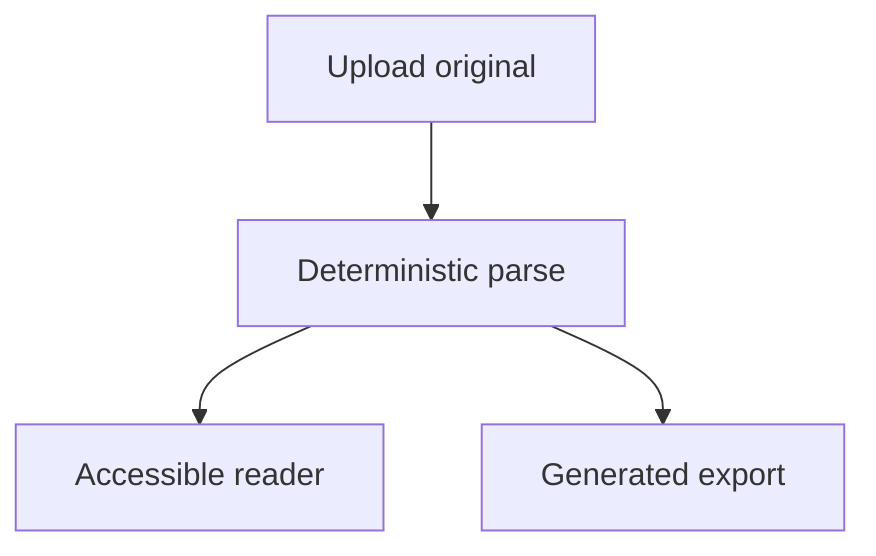

# Mermaid sample

Fenced Mermaid is preserved as a code block. ClearRead adds a **text fallback outline** — diagrams are never executed in the browser or server.

Use this fixture to verify honesty: source stays readable, outline is marked generated, no script runs.
